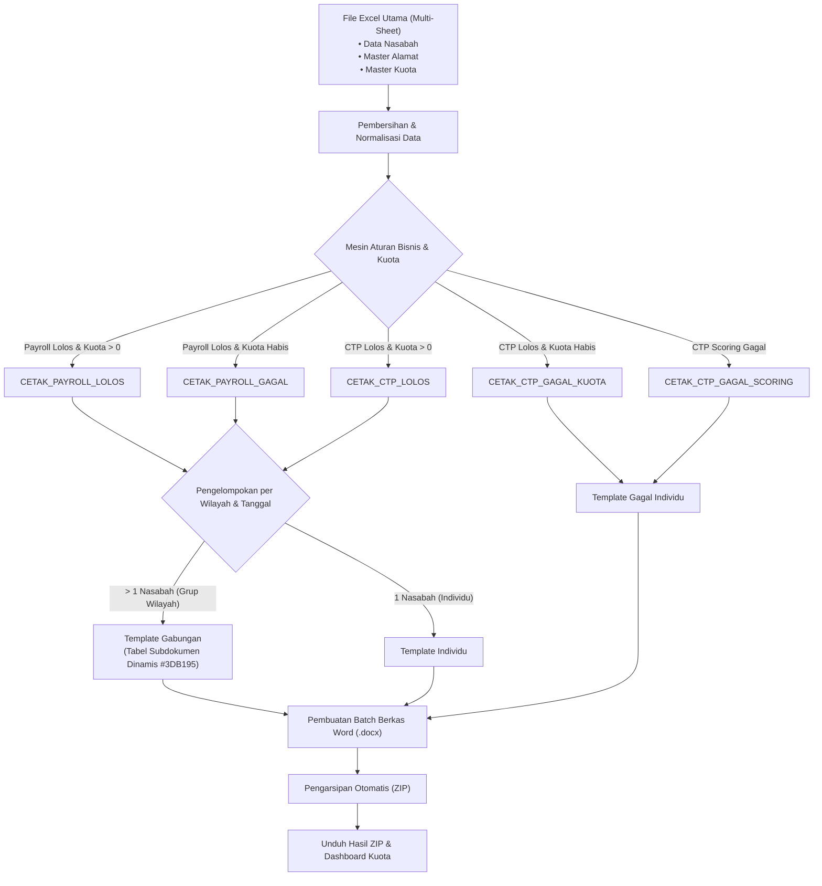

# 📑 AutoDoc Engine: Automasi Dokumen Perbankan & Monitoring Kuota

[](https://www.python.org/)
[](https://streamlit.io/)
[](https://pandas.pydata.org/)
[](LICENSE)

Aplikasi automasi dokumen dan pemantauan kuota pembiayaan tingkat *enterprise* untuk operasional perbankan dan industri keuangan. Sistem ini mengubah rekapitulasi data Excel operasional multi-sheet menjadi dokumen surat keputusan resmi Microsoft Word (`.docx`) siap cetak secara massal, dilengkapi tabel dinamis subdokumen, validasi kuota ketat *real-time*, dan pengemasan instan ke format ZIP.

---

## 🎯 Nilai Bisnis & Solusi Masalah

* **Masalah:** Pada proses persetujuan pembiayaan perbankan, staf operasional harus menyusun puluhan hingga ratusan surat keputusan persetujuan dan penolakan untuk berbagai kantor wilayah setiap harinya. Proses manual ini memakan waktu berjam-jam, rawan kesalahan pengetikan format nomor/tanggal, serta berisiko melanggar batasan kuota pembiayaan bulanan.
* **Solusi Otomatis:** AutoDoc Engine mengotomasi seluruh tahapan secara *end-to-end*:
  1. **Validasi Kuota Ketat:** Memastikan pengajuan tidak melebihi alokasi sisa kuota bulanan secara otomatis.
  2. **Pemisahan Jalur Cerdas:** Mengarahkan pengajuan ke jalur template **Payroll** atau **Committed-to-Payroll (CTP)** sesuai kriteria rekomendasi scoring.
  3. **Tipografi Indonesia Otomatis:** Mengonversi tanggal teks informal menjadi tanggal resmi bahasa Indonesia, format mata uang Rupiah, serta kapitalisasi angka Romawi kantor wilayah.
  4. **Pencetakan Fleksibel (Gabungan & Individu):** Menggabungkan nasabah dari wilayah dan tanggal yang sama ke dalam satu surat dengan tabel multi-kolom ber-styling formal, serta mencetak surat tunggal untuk pengajuan perorangan.
  5. **Pengemasan Sekali Klik:** Mengarsipkan seluruh berkas yang berhasil diproses ke dalam satu file ZIP terstruktur untuk langsung diunduh.
* **Dampak:** Memangkas waktu pembuatan dokumen dari **hitungan jam menjadi hitungan detik** dan mengeliminasi risiko kuota defisit/minus.

---

## 🏗️ Arsitektur Sistem & Alur Pemrosesan



---

## ✨ Fitur Teknis Utama

### 1. Pencetakan Jalur Ganda (Gabungan vs. Individu)
* **Pengelompokan Otomatis (*Grouping*):** Data nasabah dengan Kantor Wilayah, Status Rekomendasi, dan Tanggal Surat yang sama akan dikonsolidasikan otomatis ke dalam satu surat keputusan.
* **Tabel Subdokumen Dinamis (`python-docx`):** Menghasilkan tabel XML subdokumen dengan tata letak rapi, kolom presisi, dan latar belakang judul tabel bertema perbankan (*Teal* `#3DB195`).
* **Surat Perseorangan:** Nasabah tunggal dicetak menggunakan format surat keputusan individu khusus.

### 2. Mesin Kuota Ketat (*Strict Quota Engine*)
* Menghitung riwayat penggunaan kuota sebelumnya secara akumulatif dalam bulan yang dipilih.
* Perhitungan pengurangan kuota memastikan sisa kuota **tidak pernah minus / di bawah nol** (`max(0, sisa)`).
* Ketika kuota bulanan telah habis, pengajuan berikutnya secara otomatis dialihkan ke template penolakan kuota penuh.

### 3. Pemroses Tipografi Bahasa Indonesia Cerdas
* **Pengurai Tanggal:** Mampu membaca format tanggal numerik maupun penulisan nama bulan teks (misal: `"15 Oktober 2026"`).
* **Format Rupiah:** Mengubah angka integer mentah menjadi representasi Rupiah baku (misal: `Rp150.000.000`).
* **Kapitalisasi Romawi & Singkatan Cabang:** Menjaga penulisan angka Romawi kantor wilayah (`RO I` s.d. `RO XII`) dan akronim perbankan (`KC`, `KCP`, `BNM`).

### 4. Antarmuka Web Interaktif (Streamlit)
* Seleksi dinamis untuk sheet data nasabah, alamat, dan kuota.
* Mode cetak fleksibel: **Otomatis Semua Data** atau **Seleksi Centang Manual** menggunakan `st.data_editor`.
* Indikator *progress bar* waktu nyata dan kartu ringkasan metrik kuota bulanan.
* Fitur unduh berkas data sampel buatan langsung dari bilah sisi (*sidebar*).

---

## 📁 Struktur Repositori

```text
generate_surat_porto/
│
├── app.py                      # Aplikasi web Streamlit utama & mesin automasi dokumen
├── requirements.txt            # Daftar dependensi library Python
├── .gitignore                  # Aturan pengabaian file Git (output, cache, file sementara)
├── LICENSE                     # Lisensi sumber terbuka MIT
│
├── data/
│   └── dummy_data_pengajuan.xlsx # Berkas contoh data pengajuan sintetis (3 sheet)
│
├── template/                   # Berkas template resmi Word (.docx) yang telah dianonimkan
│   ├── template_ctp.docx
│   ├── template_ctp_gagal.docx
│   ├── template_ctp_lolos.docx
│   ├── template_ctp_lolos_individu.docx
│   ├── template_payroll_gagal.docx
│   ├── template_payroll_gagal_gabungan.docx
│   ├── template_payroll_lolos.docx
│   └── template_payroll_lolos_individu.docx
│
├── assets/                     # Aset logo bank fiktif dan stempel verifikasi
│   ├── logo_bank.png
│   └── watermark.png
│
└── output/                     # Direktori penampung hasil generate dokumen (dibersihkan oleh Git)
    └── .gitkeep
```

---

## 🚀 Panduan Menjalankan di Komputer Lokal

### 1. Kloning Repositori
```bash
git clone https://github.com/username-anda/autodoc-engine.git
cd autodoc-engine
```

### 2. Buat Lingkungan Virtual (Virtual Environment)
```bash
# Pengguna Windows
python -m venv venv
venv\Scripts\activate

# Pengguna macOS / Linux
python3 -m venv venv
source venv/bin/activate
```

### 3. Pasang Dependensi
```bash
pip install -r requirements.txt
```

### 4. Jalankan Aplikasi
```bash
streamlit run app.py
```
Aplikasi dapat diakses langsung melalui peramban (browser) di alamat `http://localhost:8501`.

---

## 🧪 Uji Coba Menggunakan Data Sampel

1. Buka aplikasi pada peramban web.
2. Perhatikan menu pada **Bilah Sisi (Sidebar)** di sebelah kiri.
3. Klik tombol **Unduh Contoh Excel (.xlsx)** untuk mendapatkan berkas data dummy siap pakai.
4. Unggah berkas yang baru diunduh tersebut ke formulir **Unggah Berkas Excel Utama**.
5. Tentukan mode cetak yang diinginkan (Semua Data atau Centang Manual).
6. Klik tombol **🚀 Proses Dokumen & Hitung Kuota**.
7. Klik tombol **📦 Unduh Seluruh Surat (ZIP)** untuk menyimpan seluruh surat keputusan hasil cetak!

---

## 🔒 Kebijakan Privasi & Kepatuhan Data

> [!NOTE]
> **100% Data Sintetis & Anonim**: Seluruh isi dokumen, template, nama nasabah (contoh: *Andi Pratama*, *Budi Santoso*), logo instansi, nama divisi, dan nomor pengajuan pada repositori ini adalah data buatan/fiktif murni untuk keperluan demonstrasi portofolio teknis. Tidak ada data rahasia, data internal, maupun data nasabah asli yang disertakan.

---

## 📄 Lisensi

Proyek ini dilisensikan di bawah lisensi terbuka [MIT License](LICENSE).
